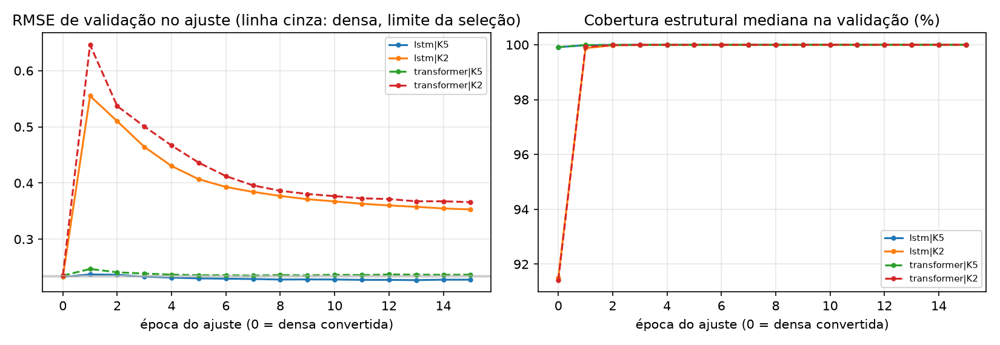
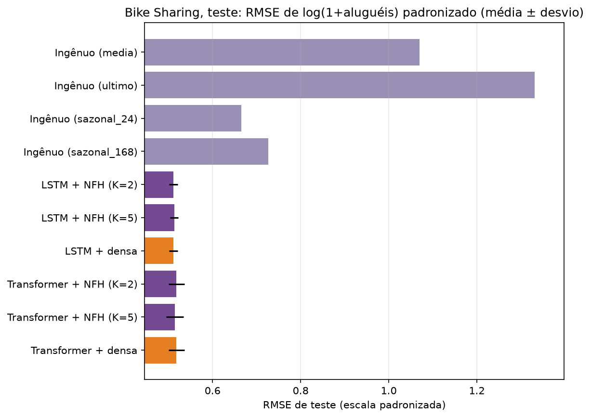
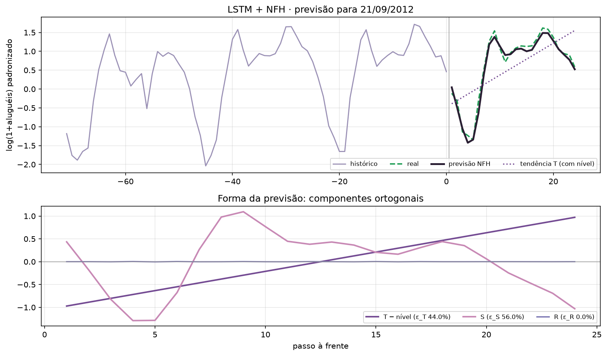

# Experimentação: biblioteca `nfh` e tutorial da Neural Fourier Head

Esta pasta contém, tudo em Python, comentado e testado:

* a **biblioteca PyTorch `nfh`**;
* um **tutorial passo a passo**;
* um **experimento completo em um conjunto novo** (UCI Bike Sharing).

A Neural Fourier Head é uma camada de saída que substitui a `nn.Linear` final de qualquer modelo de
previsão multi-passo. Junto com cada previsão, ela entrega a decomposição **exata e única** em tendência
polinomial, ciclos de Fourier e resíduo. As participações de energia somam 100%, e a camada **não tem
nenhum parâmetro a mais** que a densa.

A biblioteca segue a **versão 3 da dissertação**:

* a NFH é obtida de um modelo denso treinado, por **conversão exata** e **ajuste estrutural com seleção
  segura**;
* **explicações abdutivas** garantem formalmente o sinal da tendência e o ciclo previstos;
* as atribuições usam **Integrated Gradients** com quadratura de Gauss-Legendre.

Autor: **Rickson Livio de Souza Gaspar** (IFCE, PPGCC) · Orientador: **Dr. Thiago Alves Rocha** · Linha:
Inteligência artificial explicável com raciocínio automatizado · Licença: [BSD 3-Clause](LICENSE).

## Sumário

1. [Instalação](#1-instalação)
2. [Uso em 30 segundos](#2-uso-em-30-segundos)
3. [Estrutura](#3-estrutura)
4. [A matemática, ligada ao código](#4-a-matemática-ligada-ao-código)
5. [Duas implementações: à mão e vetorizada](#5-duas-implementações-à-mão-e-vetorizada)
6. [Acoplando a NFH a outros modelos](#6-acoplando-a-nfh-a-outros-modelos)
7. [Explicando previsões](#7-explicando-previsões)
8. [Tutorial](#8-tutorial)
9. [Experimento: UCI Bike Sharing](#9-experimento-uci-bike-sharing)
10. [Testes e reprodutibilidade](#10-testes-e-reprodutibilidade)
11. [Limitações](#11-limitações)
12. [Como citar](#12-como-citar)

## 1. Instalação

```bash
cd experimentation
uv sync --all-extras    # cria .venv com PyTorch, NumPy, pandas, matplotlib, pytest e instala `nfh`
uv run pytest           # 35 testes das garantias matemáticas
```

Sem uv: `pip install -e .` (Python ≥ 3.11). A GPU é usada automaticamente se estiver disponível.

## 2. Uso em 30 segundos

```python
import torch
from nfh import NeuralFourierHead, energy_balance

head = NeuralFourierHead(in_features=128, horizon=24, n_harmonics=5, degree=1)  # troca nn.Linear(128, 24)
out = head(torch.randn(8, 128))          # h vindo de qualquer backbone

out.forecast            # (8, 24) previsão ŷ = T + S + R
out.trend, out.seasonal, out.residual
out.amplitude           # (8, 5) amplitude A_k de cada ciclo (períodos de 24, 12, 8, 6 e 4,8 passos)
energy_balance(out)     # ε_T, ε_S, ε_R (somam 1), cobertura κ, nível
```

O procedimento da dissertação v3 (densa → conversão exata → ajuste estrutural com seleção segura):

```python
from nfh import AdjustConfig, Forecaster, abductive_explanations, latent_box, structural_adjustment
from nfh.training import TrainConfig, fit

dense = Forecaster("lstm", n_features=12, horizon=24, head="dense", n_harmonics=5, degree=1)  # ou "mlp", "convlstm", "transformer"
dense = fit(dense, train, val, TrainConfig(lam=0.0)).model         # 1. treina a densa pelo MSE
nfh0 = dense.to_nfh()                                              # 2. conversão exata: mesma previsão
res = structural_adjustment(nfh0, train, val, AdjustConfig())      # 3. 15 épocas, λ = 1000, lr 1e-4
model = res.model                                                  #    época escolhida: res.selected_epoch

box = latent_box(model, X_train)                                   # caixa de h no treino
h = model(x).latent[0].double().numpy()
abductive_explanations(model, h, box, k_cycle=1)                   # P_T e P_S: neurônios que garantem a estrutura
```

## 3. Estrutura

```
experimentation/
├── src/nfh/
│   ├── bases.py        P, F, F̃ = F(I − Π_T), Q⊥, M, D com torch.linalg (vetorizado)
│   ├── manual.py       as mesmas contas vetor a vetor (produtos internos, Gram-Schmidt)
│   ├── head.py         NeuralFourierHead (nn.Module), from_linear/to_linear, attach_nfh, decompose
│   ├── components.py   NFHOutput: previsão, componentes e desnormalização que preserva a decomposição
│   ├── adjust.py       ajuste estrutural com seleção segura a partir da densa convertida (v3)
│   ├── abductive.py    explicações abdutivas P_T e P_S (vetorizada, à mão e por força bruta) (v3)
│   ├── explain.py      balanço de energia, e_k, Integrated Gradients (Gauss-Legendre), robustez, tópicos
│   ├── model.py        backbones MLP, LSTM, ConvLSTM, Transformer + Forecaster com RevIN e to_nfh()
│   ├── data.py         janelas sem vazamento, divisão cronológica, carga do Bike Sharing
│   ├── training.py     protocolo da dissertação (Adam, λ, recorte, parada antecipada), métricas, ingênuos
│   └── plots.py        gráficos de bases, decomposição, energia, harmônicos, atribuição, comparação
├── tutorial/           01 → 06, scripts executáveis com explicação passo a passo
├── tests/              garantias, manual × vetorizado, tese, web app, dados, procedimento v3
├── data/bike_sharing/  hour.csv (UCI, CC BY 4.0) e o Readme original
└── results/            saídas e figuras dos tutoriais
```

## 4. A matemática, ligada ao código

Notação: horizonte H, grau q, K harmônicos, grade τ_j = j/H e m = q + 1 + 2K.

| Conceito (dissertação v3) | Fórmula | Código |
|---|---|---|
| Base de tendência | P[i, j] = τ_j^i | `bases.build_bases(...).P`, `manual.trend_vectors` |
| Base de Fourier | linhas cos(2πkτ) e sin(2πkτ), período H/k | `.F`, `manual.fourier_vectors` |
| Projetor da tendência | Π_T = Pᵀ(PPᵀ)⁻¹P | `.Pi_T`, `manual.project` |
| Base sazonal | F̃ = F(I − Π_T) | `.Ft` |
| Resíduo | Q⊥: base ortonormal de Img([Pᵀ Fᵀ])^⊥ | `.Q`, `manual.nfh_vectors()["resid"]` |
| Condição de dimensão | m ≤ H (contém Nyquist 2K < H) | `check_dimensions`, `max_harmonics` |
| A camada | c = W·h + b → (θ_T, θ_S, u); T = Pᵀθ_T, S = F̃ᵀθ_S, R = Q⊥u | `NeuralFourierHead.forward` |
| Amplitude e fase | A_k = √(a_k² + b_k²), φ_k = atan2(b_k, a_k) | `out.amplitude`, `out.phase` |
| Equivalência e conversão exata | NFH(h) = M D (W·h + b); da densa: W = (M D)⁻¹W' | `from_linear`, `to_linear`, `Forecaster.to_nfh` |
| Identificabilidade | (θ_T, θ_S, u) = M⁻¹ŷ | `NeuralFourierHead.decompose`, `manual.decompose` |
| Balanço de energia | ‖ŷ_c‖² = ‖T_c‖² + ‖S‖² + ‖R‖² | `explain.energy_balance` |
| Participação do harmônico | e_k = ⟨S_k, S⟩/‖ŷ_c‖², Σ e_k = ε_S | `explain.harmonic_shares` |
| Perda do ajuste estrutural | J = MSE + λ‖R‖²/H | `head.residual_penalty`, `AdjustConfig.lam` |
| Seleção segura (Prop. 4.10) | ν* ∈ argmin { J_ν : r_ν ≤ r_0 }, época 0 = densa convertida | `adjust.structural_adjustment` |
| Colunas normalizadas (NFHn) | c ← D ⊙ c, D_i = 1/‖M_{:,i}‖ | `normalize_columns=True` (padrão) |
| Integrated Gradients | I_c(v) = Σ_ℓ (X − X′)_ℓv ∫₀¹ ∂g_c/∂X_ℓv dα (Gauss-Legendre) | `explain.integrated_gradients`, `explain.quadrature` |
| Propriedades estruturais (Def. 4.11) | P_T: s·Δ_T ≥ \|Δ_T*\|/2; P_S: e*ᵀ(a_k, b_k) ≥ A_k*/2 | `abductive.structural_properties` |
| Explicação abdutiva mínima (Prop. 2.4) | ganhos δ_i = w_i h*_i − min(w_i lo_i, w_i hi_i), ordem decrescente até Γ ≥ ξ | `abductive.minimal_explanation`, `manual_minimal_explanation` |
| Estabilidade dos harmônicos | γ_k = ‖bloco k de (F̃ᵀ)⁺‖₂ | `NFHBases.seasonal_condition()` |

## 5. Duas implementações: à mão e vetorizada

* **`nfh.manual`** refaz todas as contas sem `torch.linalg` nem produtos de matrizes. Usa só produtos
  internos entre vetores 1D, Gram-Schmidt e eliminação de Gauss em sistemas pequenos. Cada função
  corresponde a uma linha de demonstração e pode ser conferida no papel (tutorial 01). Para as explicações
  abdutivas, `abductive.manual_minimal_explanation` faz o mesmo, neurônio a neurônio (tutorial 06).
* **`nfh.bases` e `nfh.head`** usam `torch.linalg` (solve, QR, posto). As bases são construídas em float64
  e o treino roda no `dtype` do modelo.

Os testes conferem que as duas implementações coincidem. A base ortonormal Q⊥ do resíduo só é única a
menos de uma rotação, porque Gram-Schmidt e QR dão bases diferentes, e por isso as coordenadas u diferem.
Mas o projetor Q⊥Q⊥ᵀ e as componentes T, S e R de qualquer previsão são idênticos (erro < 10⁻⁹), que é o
que a identificabilidade garante.

Os testes também conferem que a biblioteca reproduz a `NFHHead` dos experimentos da dissertação, quando
o código dela está disponível, e o núcleo do web app (`web_app/backend/nfh_core`).

## 6. Acoplando a NFH a outros modelos

1. **Como camada de saída** de qualquer rede: troque `nn.Linear(p, H)` por `NeuralFourierHead(p, H, K, q)`
   e use `out.forecast` na perda (opcionalmente `+ λ · head.residual_penalty(out)`).
2. **Em um modelo já treinado**, sem retreinar: `attach_nfh(model, "fc")` substitui a `nn.Linear`
   indicada por uma NFH equivalente. As previsões não mudam (Teorema da equivalência) e passam a vir
   decompostas. `NeuralFourierHead.from_linear(linear)` converte uma camada isolada, e
   `Forecaster.to_nfh()`, um `Forecaster` denso inteiro.
3. **Depois da conversão**, o ajuste estrutural com seleção segura (`structural_adjustment`) reduz o
   resíduo sem piorar a validação. É o procedimento da dissertação v3 (tutoriais 04 e 06).
4. **Para ler qualquer previsão** de qualquer modelo, até de um baseline ingênuo, `head.decompose(y_hat)`
   devolve a decomposição única na base da NFH.
5. **Na escala original**, `out.denormalize(mu, sigma)` aplica ŷ ← σŷ + μ preservando a decomposição: o
   nível entra só na tendência.

O tutorial 03 demonstra os casos 1, 2, 4 e 5.

## 7. Explicando previsões

| Pergunta | Ferramenta | Leitura |
|---|---|---|
| Qual o nível previsto? | `exp.level` | média do horizonte, toda da tendência |
| De que é feita a forma? | `exp.eps_T`, `eps_S`, `eps_R`, `coverage` | somam 100%; κ = 1 − ε_R |
| Que ciclos dominam? | `exp.shares` (e_k), `exp.amplitude`, `exp.periods` | e_k < 0 indica cancelamento; períodos longos são mal condicionados |
| A forma é relevante? | `exp.shape_rms` | compare com a variabilidade histórica antes de ler porcentagens |
| De onde vem cada parte? | `integrated_gradients(model.inner, x_norm, nomes)` | participação π_c(v) por variável, contribuição por defasagem e erro de completude; referência padrão: janela nula no espaço normalizado (com RevIN, a média da própria janela) |
| O que **garante** a estrutura prevista? | `abductive_explanations(model, h, latent_box(model, X_treino))` | menor conjunto de neurônios de h que, fixado, garante P_T e P_S para qualquer valor dos demais na caixa; `k_ig` dá o tamanho pela ordem dos IG; `violations` vem da verificação por amostragem. A garantia vale em h, não na janela de entrada |
| A explicação é estável? | `robustness(model, x)` | cosseno das participações antes e depois de ruído |
| Em palavras | `narrative(exp, attribution=...)` | tópicos em português |

## 8. Tutorial

Cada script imprime o que está fazendo e por quê. `--graficos` salva as figuras em `results/`.

| Script | Conteúdo | Tempo |
|---|---|---|
| `01_passo_a_passo_manual.py` | constrói P, F, F̃ e Q⊥ vetor a vetor e explica a previsão do exemplo da dissertação (ETTh1, H = 8), com ε_T = 21,5% (dissertação: 21,6%), ε_S = 59,0%, ε_R = 19,5% e o termo cruzado sem ortogonalizar | segundos |
| `02_garantias_numericas.py` | verifica numericamente cada garantia: Nyquist, ortogonalidade, exatidão, identificabilidade, contraste com N-BEATS-I, equivalência, energia, gradiente, estabilidade | segundos |
| `03_acoplando_em_qualquer_modelo.py` | GRU + NFH em dados sintéticos com ciclos conhecidos; `attach_nfh` num modelo pronto; `decompose`; `denormalize` | ~15 s |
| `04_experimento_bike_sharing.py` | experimento completo com o procedimento v3 (seção 9); `--rapido` testa o pipeline | ~14 min (GPU) |
| `05_explicando_uma_previsao.py` | explica uma previsão do teste como um analista: componentes, ciclos em horas do dia, variáveis, defasagens, estabilidade, comparação com a densa, tópicos | ~25 s (GPU) |
| `06_conversao_ajuste_abdutivas.py` | o Exemplo 4.17 da dissertação à mão; conversão exata; decomposição pura; ajuste época a época com a seleção segura; explicações abdutivas de uma janela e de todo o teste | ~1 min (GPU) |

```bash
uv run python tutorial/01_passo_a_passo_manual.py --graficos
uv run python tutorial/04_experimento_bike_sharing.py --graficos
uv run python tutorial/05_explicando_uma_previsao.py --graficos --backbone lstm
uv run python tutorial/06_conversao_ajuste_abdutivas.py
```

## 9. Experimento: UCI Bike Sharing

**Dados.** Aluguéis por hora do Capital Bikeshare (Washington, DC), 2011–2012, com clima e calendário:
17.379 registros, mais 165 horas ausentes preenchidas com 0, num total de 17.544 horas (Fanaee-T & Gama,
2014; UCI ML Repository, id 275; CC BY 4.0). A série tem ciclos fortes: a autocorrelação de
log(1 + aluguéis) é de 0,85 em 24 h e 0,88 em 168 h. Na dissertação v3 ele ficou como conjunto de reserva;
aqui serve de aplicação nova do mesmo procedimento.

**Tarefa.** Prever as 24 h seguintes a partir das últimas 168 h (uma semana) de 12 variáveis:

* log(1 + aluguéis);
* temperatura, sensação térmica, umidade, vento e condição do tempo;
* dia útil e feriado;
* hora e dia da semana em seno e cosseno.

**Protocolo (sem vazamento).**

1. Divisão cronológica 70/15/15 (treino até 26/05/2012, validação até 13/09/2012, teste até 31/12/2012),
   padronização só com o treino e janelas dentro de cada trecho.
2. RevIN só nas variáveis contínuas; flags e seno/cosseno ficam intactos.
3. **K** escolhido só com os alvos de **treino**: o menor K cuja base estrutural representa ≥ 98% da forma
   dos perfis reais de 24 h. Deu K = 5. Repete-se tudo com **K = 2** (ciclos de 24 h e 12 h, cobertura dos
   perfis de treino de 89,2%), para ver a seleção segura quando a base é compacta.
4. Procedimento v3, para cada backbone (LSTM e Transformer) e semente (0, 1, 2):
   * treina-se a **densa** (Adam 10⁻³, decaimento 10⁻⁵, lotes de 64, recorte 1,0, até 40 épocas, paciência 6);
   * converte-se exatamente em NFH;
   * faz-se o **ajuste estrutural** de 15 épocas (λ = 1000, lr 10⁻⁴);
   * a **seleção segura** é feita na validação.
5. A comparação no teste é contra a **mesma** densa e contra baselines ingênuos: média, último valor,
   repetir ontem e repetir a semana passada. Também se registra a "estrutura completa", o menor J sem a
   restrição de RMSE.

### Resultados (3 sementes, teste: 13/09/2012 a 31/12/2012, 2.441 janelas)

Executado numa RTX 3070 Laptop em 13,6 minutos (`results/04_bike_sharing/`, log em `execucao.log`).

| Modelo | RMSE (log padronizado) | MAE (bicicletas/h) | κ mediana | κ mínima |
|---|---|---|---|---|
| Ingênuo: média de treino | 1,070 | 182,9 | — | — |
| Ingênuo: último valor | 1,331 | 208,3 | — | — |
| Ingênuo: repetir ontem (24 h) | 0,665 | 78,0 | — | — |
| Ingênuo: repetir a semana passada (168 h) | 0,727 | 72,5 | — | — |
| LSTM + densa (K = 5 na leitura) | **0,511 ± 0,010** | 55,0 | 99,9% | 98,6% |
| LSTM + NFH, seleção segura, K = 5 | 0,513 ± 0,009 | **53,5** | 100,0% | 100,0% |
| LSTM + NFH, seleção segura, K = 2 | 0,511 ± 0,010 | 55,0 | 91,9% | 71,2% |
| LSTM + NFH, estrutura completa, K = 2 | 0,588 ± 0,014 | 92,1 | 100,0% | 100,0% |
| Transformer + densa (K = 5 na leitura) | 0,518 ± 0,018 | 59,7 | 99,9% | 99,4% |
| Transformer + NFH, seleção segura, K = 5 | **0,515 ± 0,020** | **58,7** | 100,0% | 99,8% |
| Transformer + NFH, seleção segura, K = 2 | 0,518 ± 0,018 | 59,7 | 92,0% | 76,0% |
| Transformer + NFH, estrutura completa, K = 2 | 0,576 ± 0,021 | 93,6 | 100,0% | 100,0% |

**O que os números mostram.**

* **Todos os modelos neurais superaram com folga os baselines.** O RMSE ficou de 22% a 23% menor que o de
  repetir o dia anterior, o melhor ingênuo.
* **A conversão é exata:** a diferença máxima entre a previsão da densa e a da NFH convertida ficou entre
  4,8 × 10⁻⁷ e 7,2 × 10⁻⁷. A época 0 é, portanto, a densa.
* **K = 5: o ajuste mexeu pouco na acurácia e completou a estrutura.**
  * LSTM: a seleção escolheu as épocas 15, 12 e 15. O RMSE de teste ficou **0,30% acima** da densa nas 3
    sementes, embora o RMSE de validação fosse menor em todas: a seleção garante a validação, não o teste.
    O MAE caiu de 55,0 para 53,5.
  * Transformer: épocas 0, 13 e 15, com RMSE **0,59% abaixo** da densa (melhor em 2 sementes, igual em 1).
  * Nos dois, a cobertura mínima no teste subiu: de 98,6% para 100,0% e de 99,4% para 99,8%.
  * As diferenças são menores que a variação entre sementes (± 0,009 a 0,020).
* **K = 2: o caso que justifica a seleção segura.**
  * A decomposição pura da densa explica 91,9% da forma (mediana), mas há janelas com só 71,2%.
  * Forçar a estrutura (estrutura completa, cobertura de 100%) custa caro: RMSE +15% na LSTM e +11% no
    Transformer.
  * Nenhuma época do ajuste ficou abaixo do RMSE de validação da densa. A seleção manteve a época 0 nas
    6 execuções: a NFH é a densa decomposta, e o resíduo é relatado como resíduo. Na dissertação, com
    K = 2, a seleção também manteve a época 0 com mais frequência que com K = 10 (58% contra 20% dos runs,
    Tabela 7).
* **Explicações abdutivas** (tutorial 06, LSTM, semente 0, K = 5, nas 2.441 janelas de teste):
  * P_T fixa em mediana 47,7% dos 128 neurônios de h e P_S, 46,1%;
  * a ordem dos Integrated Gradients exigiria 1,47 e 1,38 vezes mais neurônios;
  * 0 violações nas verificações por amostragem.
  * A faixa |𝒜|/p fica próxima dos 47–53% relatados na dissertação para os conjuntos dela.
* **O ajuste não mudou o número de parâmetros:** 64.920 na LSTM e 79.448 no Transformer, com densa ou NFH.





**Uma previsão explicada (tutorial 05, LSTM + NFH da seleção segura, sexta-feira 21/09/2012).**

* **Previsão:** 7.330 aluguéis no dia (real: 8.167), com pico às 17 h (≈ 697/h; real às 17 h, 846/h).
* **Erro:** MAE de 45,2 bicicletas/h, contra 49,0 de repetir o dia anterior. Nesta janela, a densa de
  origem errou menos (24,6).
* **Forma:** tendência 44,0% e sazonalidade 56,0%, com resíduo 0,0%. A sazonalidade é dominada pelos ciclos
  de 24 h (e₁ = 30,9%), 12 h (12,6%) e 8 h (8,0%).
* **Variáveis:** a hora do dia (`hr_cos` 37,6%, `hr_sin` 25,5%) sustenta a sazonalidade; os aluguéis
  recentes (`cnt`, 35,7%) e a hora sustentam o nível.
* **Em 50 janelas de teste:** o ciclo de 24 h domina em 49, a sazonalidade responde em média por 76,1%
  (± 19,2%) da forma, e a robustez a ruído na janela explicada é 1,000.



Outras figuras estão em `results/05_explicacao/{harmonicos,atribuicao_variaveis,energia_janelas}.png`.
Os modelos da semente 0 ficam em `results/04_bike_sharing/modelos/` para os tutoriais 05 e 06:

* densa: `*_dense_s0.pt`;
* NFH da seleção segura: `*_nfh_s0.pt` (K = 5) e `*_nfh_K2_s0.pt` (K = 2), com a trajetória do ajuste.

## 10. Testes e reprodutibilidade

```bash
uv run pytest -v
```

São 35 testes:

* **Garantias:** ortogonalidade e completude dos subespaços, condição de dimensão, exatidão,
  identificabilidade, balanço de energia, energia de cada harmônico ≤ (H/2)A_k², número de parâmetros.
* **Equivalência e acoplamento:** equivalência com a densa nos dois sentidos, `attach_nfh`, fluxo de
  gradiente, RevIN.
* **Explicações e implementações:** completude dos Integrated Gradients, implementação manual ×
  vetorizada, equivalência com o código da dissertação e com o web app, salvaguardas de dados.
* **Procedimento v3** (`tests/test_v3.py`):
  * conversão exata densa → NFH nos 4 backbones;
  * a seleção segura nunca piora a validação e escolhe o menor J viável;
  * a explicação abdutiva vetorizada e a manual coincidem com a enumeração de todos os subconjuntos
    (200 instâncias com p = 7);
  * suficiência sem violações num modelo;
  * a quadratura de Gauss-Legendre é exata até grau 2n − 1.

As sementes são fixadas (`training.set_seed`). A GPU não é totalmente determinística (cuDNN), então
reexecuções podem variar na 3ª casa decimal.

## 11. Limitações

* A NFH tem a mesma capacidade de uma camada densa. A conversão não muda nada, e o ajuste estrutural muda
  a acurácia pouco, nos dois sentidos. A seleção segura garante a validação, não o teste: aqui, a LSTM com
  K = 5 ficou 0,30% pior que a densa no teste.
* Com base compacta (K pequeno), a seleção pode recusar todo o ajuste e devolver a densa decomposta, com
  resíduo visível (K = 2 acima). É o comportamento esperado, não uma falha.
* As explicações abdutivas garantem propriedades no espaço da última camada (neurônios de h dentro da
  caixa do treino), não diretamente para janelas de entrada. A caixa empírica pode ser estendida quando h*
  sai dela.
* Ciclos com período maior que o horizonte (ex.: semanal num horizonte de 24 h) não são harmônicos:
  aparecem no nível e na tendência.
* Harmônicos de período longo são mal condicionados (γ_k grande) e devem ser lidos com cautela.
* A atribuição por variável é local e não causal. Com ReLU no backbone, o integrando dos IG tem quinas, e
  o erro de completude não cai de forma monotônica com o número de nós. O backbone continua uma
  caixa-preta.

## 12. Como citar

Use o arquivo [`CITATION.cff`](CITATION.cff) ou:

> GASPAR, Rickson Livio de Souza. **Neural Fourier Head: Explicabilidade Intrínseca via Decomposição
> Espectral para Modelos de Deep Forecasting Multi-step.** Dissertação (Mestrado em Ciência da
> Computação), IFCE, PPGCC. Orientador: Dr. Thiago Alves Rocha. Linha de pesquisa: Inteligência
> artificial explicável com raciocínio automatizado.

Dados: Fanaee-T, H.; Gama, J. Event labeling combining ensemble detectors and background knowledge.
*Progress in Artificial Intelligence*, 2, 113–127, 2014. doi:10.1007/s13748-013-0040-3.
